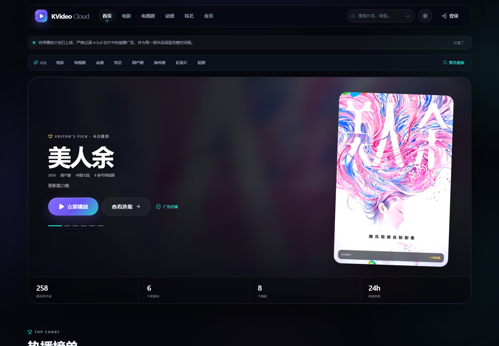

# KVideo Cloud · 纯净放映室

> 一个运行在 **Cloudflare Workers** 上的视频聚合放映室。以 KVideo 的 Liquid Glass 视觉语言为灵感，从资源站拉取海报与内容，提供爱奇艺式频道分类、**切片级 HLS 广告过滤**、D1 账号体系、八种用户组、会员通行证与完整积分系统。

**线上地址**：<https://kvideo-cloud.2784355408.workers.dev>  
> `workers.dev` 在中国大陆部分网络会被 DNS 污染 / SNI 阻断；如无法打开，请在 Cloudflare Dashboard 为 Worker 绑定自有域名。



## 为什么是 KVideo Cloud

很多 HLS 广告并不是“贴片”，而是被服务端直接缝进媒体播放列表：`CUE-OUT` 之后插入几段广告切片，再以 `CUE-IN` 回到正片，或者干脆用不同的切片目录、时长网格伪装成正常内容。

KVideo Cloud 的代理会在云端解析每一份主/子播放列表，识别并移除这些切片，再重写所有媒体、密钥、`EXT-X-MAP` 与 I-frame URI，让浏览器只看到一条干净的、带签名的时间轴。

## 功能

### 严格 HLS 广告过滤

- **显式广告信号**：`EXT-X-CUE-OUT` / `CUE-OUT-CONT` / `CUE-IN`、`EXT-X-AD`、`EXT-X-ASSET`、SCTE-35、`EXT-X-PLACEMENT-OPPORTUNITY`。
- **HLS Interstitial**：清理 `EXT-X-DATERANGE` 中的 `com.apple.hls.interstitial`、`X-ASSET-URI`、`X-ASSET-LIST` 等字段，避免播放器预加载广告资产。
- **广告块指纹**：按 `EXT-X-DISCONTINUITY` 分块，比较主内容块的 host、目录、文件名前缀、时长中位数与切片签名。
- **切片级识别**：即使没有 CUE 标签，单独的 `midroll-ad-01.ts` 也会被文件名与查询参数规则识别。
- **重复签名**：同一段广告序列在清单中重复出现时，标记为非主内容块。
- **安全阈值**：严格模式要求多信号交叉验证，单独“时长偏短”不会触发删除；如果所有切片都被判为广告，则触发 `guard-all-removed`，保留原清单，绝不返回空时间轴。
- **时间轴修复**：移除广告后清理首尾与重复的不连续点，保留必要边界，并同步调整 `EXT-X-MEDIA-SEQUENCE`。
- **四种模式**：`strict`（默认）/ `standard` / `aggressive` / `off`，每个播放会话独立签名。
- **客户端提示**：从清单响应头读取 `X-KV-Ads-Removed`，播放器顶部实时显示已净化切片数。

### 动态首页与频道

- 首页从 6 个 `normal` 资源站拉取最新 3 页内容，并额外抓取电影分类页；合并同名影片、收藏线路与海报。
- 爱奇艺式频道：电影、电视剧、动漫、综艺、国产剧、海外剧、纪录片、短剧。
- 每个频道展示资源站海报、年份、类型、备注、评分与可用线路数。
- 首页包含今日推荐 Hero、热播榜单、各频道精选、会员与排行榜模块。
- 静态测试片源已从首页/频道移除，仅保留技术路由，不再出现在主内容区。
- 点击海报进入 `/resource/:source/:id`，直接读取资源站详情、剧集与播放线路。
- hls.js 播放器：清晰度切换、倍速、音量、全屏、画中画、键盘快捷键、错误重试。
- 自定义 HLS 片源，按用户组限制 3–100 个额度，仅所有者可见。

### 资源站目录

- 从 `2334.json` 导入 78 个源站配置，按 `group` 字段过滤掉 22 个 `premium` 资源，保留 56 个 `normal` 资源站。
- `/sources` 页面支持搜索、分组过滤、连接检测、复制 API 地址与原始 JSON 跳转。
- 数据静态写入 `data/video-sources.json`，重新导入：`npm run import:sources`。
- 连接检测通过 Worker 端安全代理完成，只允许目录中的 `baseUrl`，并带每 IP 限流。

### 聚合搜索与播放

- 顶部搜索框默认进入 `/search`，自动把关键词分发到 56 个资源站；每批 8 个源、3 路并发，边搜边出结果。
- 自动合并同名影片，按收录线路数排序，展示不同资源站的线路数量与来源标签。
- 点击结果读取该源详情，解析 `vod_play_from` / `vod_play_url` 播放组与剧集。
- 支持直链 `.m3u8` / `.mp4`，也支持从播放分享页二次解析媒体地址。
- 播放需要登录；优先使用浏览器直连 + 客户端严格广告过滤，直连失败时自动回退到 `/api/hls` 签名代理。
- 部分资源站的 CDN 会拦截 Cloudflare 数据中心出口 IP，因此浏览器直连是主要播放通道；直连同样会在 HLS.js 加载清单时执行广告过滤。
- 搜索、详情、播放 API：
  - `GET /api/aggregate/search?q=&ids=`
  - `GET /api/aggregate/detail?source=&id=`
  - `POST /api/aggregate/play`

### 账号、用户组与会员

- 邮箱注册 / 登录，PBKDF2-SHA256（100,000 次）密码哈希，HttpOnly + SameSite=Lax 会话 Cookie，会话哈希落库。
- 8 种身份：游客、注册影迷、资深影迷、光影会员、星幕会员、永恒会员、管理员、超级管理员。
- 6 级成长体系：新芽 → 常客 → 旅人 → 鉴赏家 → 造梦师 → 放映员。
- 会员通行证：月度 / 季度 / 年度 / 永恒，积分兑换，积分倍率 1.2× / 1.5×。
- 积分系统：注册 50、签到 10–22、收藏 +2、观看 +2（每日上限）、邀请 +80。
- 邀请码、连续签到、积分流水、成长值榜单。
- 评论、收藏、观看历史、自定义片源。
- 管理后台：统计、用户组调整、积分增减、封禁、会员调整、全站公告、广告过滤策略与关键词。

### VIP 标签与运营后台

- 管理员可一键开启“全站影片 VIP”，首页、频道、搜索、详情全部显示 VIP 标签并限制免费用户播放。
- “搜索结果自动 VIP”：搜索出来的影片自动带 VIP 标签，无需逐条打标。
- 支持按标题 / 年份 / 资源站 / 影片 ID 手动打标，附加“独播、4K、会员抢先”等自定义标签。
- VIP 播放权限由服务端校验：光影会员、星幕会员、永恒会员与管理员可播放。
- 管理员后台新增“内容与 VIP”页：全站策略、搜索策略、注册策略、注册赠送积分、手动打标与标签列表。
- “仅邀请注册”与自定义欢迎积分可在后台即时开关，无需重新部署。

### 播放页与性能

- 资源播放页采用播放器 + 右侧“选集与线路”双栏布局，支持电视模式、收藏、线路切换、剧集切换与面板隐藏。
- HLS 首屏参数优化：更短的初始缓冲、快速 ABR 估算、更短的 manifest/level 超时，提升起播速度。
- 浏览器直连播放时由 HLS.js loader 执行严格广告过滤，无需经过受源站风控影响的 Cloudflare 出口。

### 设计与安全

- Liquid Glass：玻璃拟态、极光渐变、颗粒噪点、动态光斑、海报艺术生成器（无外部图片依赖）。
- 深色 / 浅色主题、响应式桌面 + 移动底栏。
- 8 种海报母题：orb / rings / beam / grid / bloom / wave / prism / glitch。
- 签名代理：HMAC-SHA256 签名 + 过期时间，防开放代理滥用。
- SSRF 防护：仅 http/https，拒绝 localhost、内网 IPv4/IPv6、元数据地址与非标准低端口。
- 同源校验、CORS 白名单、CSP、安全响应头、登录与评论限流。

## 技术栈

| 层 | 技术 |
| --- | --- |
| 运行时 | Cloudflare Workers |
| API | Hono + TypeScript |
| 前端 | React 19 + Vite + 原生 CSS |
| 播放器 | hls.js |
| 数据库 | Cloudflare D1（SQLite） |
| 静态资源 | Workers Static Assets |
| 测试 | Vitest（广告过滤）+ Node 集成 smoke |

## 目录

```text
worker/
  index.ts              Worker 入口、鉴权中间件、安全头
  lib/auth.ts          PBKDF2、会话、邀请码、初始化管理员
  lib/db.ts            D1 类型、设置、用户映射
  lib/points.ts        签到、积分、等级
  lib/proxy.ts         签名 HLS 代理、重写、过滤头
  lib/sign.ts          HMAC 签名 / SSRF 校验
  routes/              auth / public / feed / aggregate / library / membership / admin
shared/
  adfilter.ts          纯函数广告过滤引擎
  aggregate.ts         聚合搜索类型
  catalog.ts           公开测试片库
  feed.ts              首页频道、资源卡片与分类类型
  levels.ts            用户组、等级、会员方案
  sources.ts           资源站类型与统计
  types.ts             共享类型
data/
  video-sources.json   过滤 premium 后的 56 个资源站
  video-sources.meta.json
src/                   React 前端
migrations/            D1 初始化 SQL
tests/                 广告过滤与资源站单元测试
scripts/               smoke、导入、本地预览、截图
```

## 本地运行

要求：Node.js 24+。

```bash
npm install
npm run build
npm run dev:local
```

打开 `http://127.0.0.1:8787`。

重新导入资源站并过滤 `premium`：

```bash
npm run import:sources
```

如果本机访问 raw.githubusercontent.com 不稳定，可以先把 JSON 下载到本地，再执行：

```bash
SOURCE_FILE=./2334.json npm run import:sources
```

`dev:local` 使用真实的 Hono Worker 代码 + 一个 D1 形状的 Node SQLite 适配器。它只用于本地预览和自动化测试；生产环境使用 Cloudflare D1。

本地演示管理员：

```text
邮箱：admin@kvideo.cloud
密码：KVideo-Admin-2026!x7Qm
```

> 这组账号仅存在于本地 mock 数据库。生产管理员由 Cloudflare Secret 首次初始化，请务必使用不同密码。

也可以使用标准 Wrangler 本地开发（需要可用的 workerd 运行环境）：

```bash
cp .dev.vars.example .dev.vars
npm run db:migrate:local
npm run dev:worker
npm run dev        # 另一个终端，Vite 代理 /api 到 8787
```

## 部署到 Cloudflare

### 1. 登录并创建 D1

```bash
npx wrangler login
npx wrangler d1 create kvideo-db
```

把输出的 `database_id` 写入 `wrangler.jsonc`：

```jsonc
"d1_databases": [
  {
    "binding": "DB",
    "database_name": "kvideo-db",
    "database_id": "xxxxxxxx-xxxx-xxxx-xxxx-xxxxxxxxxxxx",
    "migrations_dir": "migrations"
  }
]
```

### 2. 写入密钥

```bash
npx wrangler secret put SESSION_SECRET
npx wrangler secret put PROXY_SECRET
npx wrangler secret put BOOTSTRAP_ADMIN_EMAIL
npx wrangler secret put BOOTSTRAP_ADMIN_PASSWORD
```

- `SESSION_SECRET` / `PROXY_SECRET`：至少 32 字节的随机字符串，可用 `openssl rand -base64 48`。
- `BOOTSTRAP_ADMIN_*`：首次访问注册/登录接口时自动创建超级管理员；创建成功后可以删除这两个 Secret。

### 3. 迁移并部署

```bash
npm run db:migrate:remote
npm run deploy
```

第一次打开站点后，用 `BOOTSTRAP_ADMIN_EMAIL` + `BOOTSTRAP_ADMIN_PASSWORD` 登录，即可进入 `/admin`。

### 4. 自定义域名（可选）

```bash
npx wrangler domains add video.example.com
```

或在 Cloudflare Dashboard 的 Workers → Settings → Domains & Routes 中绑定。

## 测试

```bash
npm test                  # 广告过滤单元测试
npm run build
npm run dev:local         # 另开终端
npm run smoke             # 注册 / 签到 / 收藏 / 评论 / 播放 / 代理 / 会员 / 后台
```

广告过滤测试覆盖：正常 VOD 不误伤、CUE 广告块、跨域广告岛、伪装切片、主清单 Interstitial、全量保护、模式严格度与 URI 重写。

## 广告过滤设计说明

1. **解析**：保留原始行，记录每个切片的 `EXTINF`、时长、行号、不连续块与 CUE 状态。
2. **主模式学习**：以总时长最大的块作为主内容块，学习 host、目录、文件名前缀与时长中位数。
3. **分块打分**：路径不匹配、文件名不匹配、时长异常、重复签名、夹在中间的短块分别计分。
4. **严格阈值**：必须有多信号交叉验证；主内容块只有明确 CUE 或全量关键词才会被移除。
5. **重建**：只移除广告切片与广告标签，保留 AES key / MAP 等状态标签；最后修复不连续点。
6. **兜底**：全部切片被判定为广告时返回原清单并记录保护原因。

欢迎提交新的广告样本与测试用例。

## 已知限制

- Cloudflare Workers 免费套餐有 CPU 时间限制；超长播放列表（数千切片）会消耗更多 CPU。
- 原生 Safari HLS 播放无法在客户端读取过滤统计，但服务端过滤仍然生效。
- 本项目不提供任何影视内容，只内置公开授权测试流；自定义片源由部署者自行承担合规责任。
- 未接入真实支付；会员使用积分兑换。

## 致谢

- 视觉与产品概念灵感来自 [KuekHaoYang/KVideo](https://github.com/KuekHaoYang/KVideo)（MIT）。
- 片库来自 [Blender Open Movies](https://studio.blender.org/films/)、Apple、Google Shaka、Mux 与 Unified Streaming 的公开测试资源。
- 本项目为独立实现，未复制上游代码。

## License

MIT © 2026 KVideo Cloud contributors
